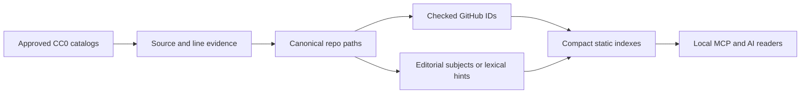

<div align="center">

# 🪐 RepoOrbit

### A repository atlas made for AI agents

**Discover · Classify · Verify · Navigate**

*Un atlas de repositorios diseñado para agentes de IA, sin desperdiciar contexto.*

[](https://github.com/chrishotza/Repo-Orbit/actions/workflows/corpus.yml)
[](https://github.com/chrishotza/Repo-Orbit/actions/workflows/python-app.yml)

**[Agent contract](agent.json) · [AI instructions](AGENTS.md) · [Browse subjects](ai/categories/index.json) · [Evidence policy](docs/TAXONOMY.md) · [Current coverage](ai/status.json)**

</div>

---

## A catalog that knows what it *doesn't* know

Most repository lists tell you **where a link points**. RepoOrbit also tracks **who referenced it, what evidence exists, how it may be classified, and what remains unverified**. Its primary interface is machine-readable JSON and local MCP tools; this page is just an introduction.

| Indexed paths | GitHub IDs checked | Topical domains | Subjects assigned | Subjects unknown |
|:---:|:---:|:---:|:---:|:---:|
| **1,462** | **58** | **14** | **309** | **1,153** |

<sub>Snapshot: 2026-10-13. Of the 309 subject labels, 34 are editorial, 23 are supported by pinned upstream README descriptions, and 252 are lower-confidence lexical hints. Counts are not claims of running/free software. The current machine-readable values are in [ai/status.json](ai/status.json).</sub>

## ⚡ Built for agents, not long prompts

| Agent wants to… | Compact interface |
|---|---|
| Find an app by a documented EN/ES task | `recommend({"q":"generar videos con IA", "limit":3})` |
| Route a subject request in Spanish or English | `route_topic({"q":"necesito ciberseguridad"})` |
| List available subject areas | `categories({})` |
| Browse a domain | `browse({"category":"ai-ml","limit":5})` |
| Ask why a repository has a subject label | `classify({"repo":"Comfy-Org/ComfyUI"})` |
| Search names and limited topic tags | `search({"q":"python","limit":3})` |
| Resolve exact evidence or numeric ID | `resolve({"repo":"id:589831718"})` |
| Explore a specific GitHub owner | `owner_repos({"owner":"sindresorhus","limit":5})` |
| Inspect the age of a real GitHub observation | `evidence_age({"repo":"id:23088740"})` |
| Inspect coverage and uncertainty | `stats({})` |

**No hosted service, paid API, embedding model or LLM is needed for these offline queries.** A host can launch the bundled Python MCP stdio server or an agent can read only the small static index it needs. LLM response tokens are not literally zero: bounded JSON simply avoids putting the corpus into context.

### Read only what you need

| Machine-readable entry | Purpose |
|---|---|
| [`agent.json`](agent.json) | Versioned agent protocol and tool manifest |
| [`ai/categories/index.json`](ai/categories/index.json) | ~1.2 KB subject router; 14 areas + unclassified |
| [`ai/categories/ai-ml.json`](ai/categories/ai-ml.json) | One area, no other shards loaded |
| [`ai/index.json`](ai/index.json) | Alphabetic lexical index manifest |
| [`ai/intent.json`](ai/intent.json) | 8 curated bilingual task intents |
| [`ai/identities.json`](ai/identities.json) | 34 verified seed numeric IDs |
| [`ai/verified-targets.json`](ai/verified-targets.json) | 24 additional checked reference IDs |
| [`ai/status.json`](ai/status.json) | Tiny, reproducible coverage summary |
| [`ai/owners/index.json`](ai/owners/index.json) | 622-byte owner router; fetch just one bucket and up to 64 slugs per page |
| [`ai/topic-route-eval.json`](ai/topic-route-eval.json) | 32 explicit EN/ES routing regression cases, *not* semantic accuracy |
| [`ai/evidence-dates.json`](ai/evidence-dates.json) | Historical numeric-ID and README evidence dates (not live project activity) |
| [`data/topic_evidence.jsonl`](data/topic_evidence.jsonl) | 23 original short subject statements, SHA and line pointers |


<details>
<summary><strong>Advanced agent filter: browse by verified source context</strong></summary>

An agent can pass `source: "github:sindresorhus/awesome-nodejs"` to `browse` while selecting any subject, including `unclassified`. That indicates a repository was **linked by that approved catalog**; it is not a verified Node.js-compatibility or execution claim. `classify` also exposes source IDs separately from topical hints.

</details>

## 📦 Owner pages that scale without giant prompts

From the [622-byte routing manifest](ai/owners/index.json), a remote-only agent opens the owner's first-letter bucket and selects a page of at most 64 paths using explicit slug boundaries. Today's 1,215 approved paths occupy 29 buckets and 35 pages. All previously checked IDs keep their distinct existence flags.

Global licensed-source delta reports count a repo linked by two catalogs **once**, with two exact source/line/hash pointers. Removed links never imply a deleted repository. [Incremental scale contract](docs/INCREMENTAL_SCALE.md).

## 🧭 Our classification system

RepoOrbit uses an original controlled vocabulary with 14 domains, such as **AI/ML**, **developer tools**, **security**, **cloud infrastructure**, **creative media**, **education**, **science** and **automation**. Every subject result includes the method used to derive it.

| Evidence tier | Source of label | Interpretation |
|---|---|---|
| **Editorial** (`e`) | 34 individually checked seed repositories | An editorial subject, not proof of functionality |
| **README-backed** (`d`) | 23 versioned upstream README lines | Auditable self-description, not an execution test |
| **Lexical hint** (`h`) | Whole words in a discovered repository's name | A suggestion, never a verified capability |
| **Ambiguous** (`a`) | Competing equally specific keywords | Remains unclassified |
| **Unknown** (`u`) | No defensible topical clue | Remains unclassified |

**We prefer abstaining over hallucinating.** A new read-only review queue stages source-anchored candidate excerpts and treats upstream README instructions as untrusted data. The 23 README-backed labels link to exact historical Git blobs and line numbers, not just names. [See audited evidence](docs/README_EVIDENCE.md). A GitHub link existing is not a benchmark, installation test, safety audit, license clearance or proof of free operation. [Read the classification methodology](docs/TAXONOMY.md).

## 🔎 Traceable from discovery to agent result



Source links are preserved with their original Git blob SHA, catalog identifier and line number. GitHub numeric identities help detect renames without confusing a fork or reused slug with the same project. New sources are rights-reviewed; monitored updates are staged and proposed through **reviewable draft pull requests**, never silently merged.

## 🌍 Four additional CC0 catalogs, verified at the source

We individually checked the upstream repositories and their CC0 1.0 license files before extracting GitHub **link references** from their pinned README blobs. New approved directories: **Awesome npm (64 references)**, **Awesome Electron (145)**, **Awesome Observables (13)** and **Awesome TAP (42)**. Combined with the two earlier feeds, that is **1,463 source links** and **1,462 unique approved repository paths** (including separately checked seed entries). This adds **247 distinct paths**; it does not verify that those linked projects exist, run or are completely free. Each link retains the original source, Git blob SHA and line. [License and source evidence](docs/FEED_EXPANSION.md).

## 🌱 Coverage, not hype

**1,463 catalog reference edges** come from six individually reviewed CC0-licensed discovery directories, and deduplicate into a corpus of 1,462 unique paths together with the registered seed repositories. Most discovered references are still unchecked against GitHub. Only 58 stable IDs have independent repository-existence observations. **Zero** repositories have been independently marked both functionally tested and free to run by RepoOrbit.

Daily, read-only rotating review jobs now inspect different **bounded** pages of pending GitHub references; no automatic approvals or free/functional claims. [Empirical coverage and evidence age](docs/COVERAGE_FRESHNESS.md).

Track engineering gates in [Roadmap](docs/ROADMAP.md), [Source provenance](docs/PROVENANCE.md), [ID verification](docs/TARGET_VERIFICATION.md), and [CI results](https://github.com/chrishotza/Repo-Orbit/actions).

## 🤖 Integration

An MCP-compatible agent host can use this entry in its own configuration (the host launches the server, not the end user):

```json
{"mcpServers":{"repoorbit":{"command":"python3","args":["-m","repoorbit.mcp"],"cwd":"/path/to/Repo-Orbit"}}}
```

Agent-only readers with no process execution can start at [`agent.json`](agent.json), then fetch [`ai/categories/index.json`](ai/categories/index.json) and **only their chosen category shard**. No terminal tutorial or full-corpus prompt is necessary.

---

<div align="center">

**Evidence before confidence. Small responses before giant prompts.**

[Agent navigation](AGENTS.md) · [Taxonomy](docs/TAXONOMY.md) · [Contribute](CONTRIBUTING.md)

<sub>RepoOrbit publishes original metadata and pointers, not mirrored third-party source code. Upstream repository licenses remain independent. RepoOrbit's own project-wide license has not yet been selected by its maintainer.</sub>

</div>
